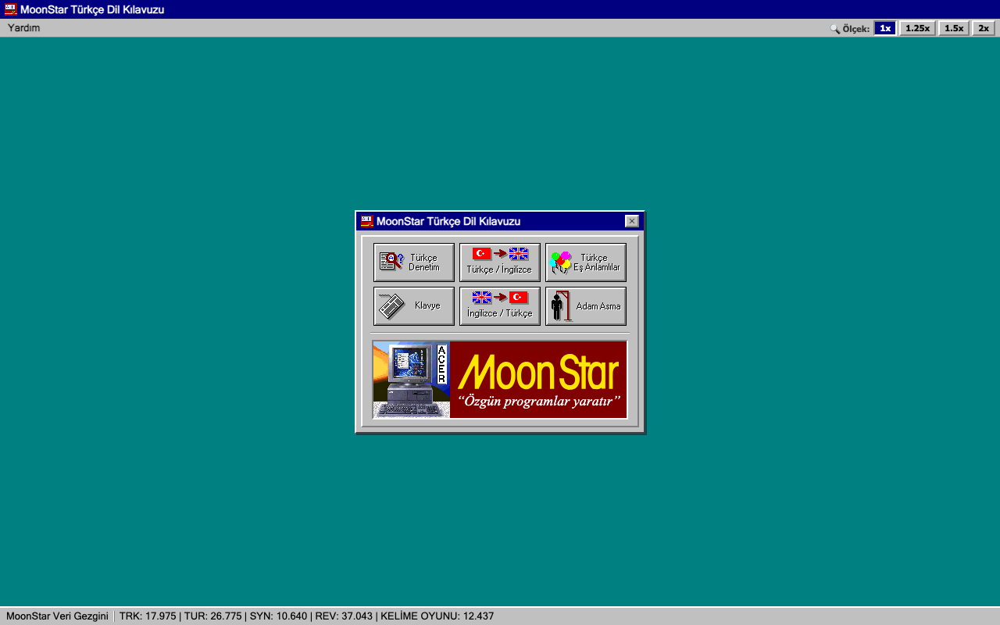

# MoonStar — Reverse Engineering

**MoonStar Türkçe Denetim Editörü** — 1995 tarihli Borland C++ Win16 uygulamasının
veri dosyalarının tersine mühendislik belgesi.



**Canlı:** https://yasinkuyu.github.io/moonstar/

**Doğrulama:** EXE'nin kendi kodu bir x86 emülatöründe gerçek veriyle çalıştırılıp port ile
karşılaştırıldı:

| Bileşen | Sonuç |
|---|---|
| Eş anlamlılar | 13.829 / 13.829 kelime aynı |
| Türkçe → İngilizce | 26.452 / 26.452 kelime aynı (`ahfat` orijinal programı kilitliyor) |
| Yazım denetimi + öneriler | 9.670 / 9.670 kontrol aynı |

---

## Dosya Mimarisi (EXE'den Doğrulanmış)

```
MTU.TUR  ──▶  Türkçe kelime listesi (26,775) + 3,218 ek kaydı + morfolojik sınıflar
          └──▶ Leb Demeden, yazım denetimi ve bütün Türkçe sözlüklerin kelime kaynağı

MTU.TES  ──▶  Türkçe Eş Anlamlı Sözcükler (TUR indeksli, FUN_1010_256c)
MTU.ING  ──▶  Türkçe İngilizce Sözlük     (TUR indeksli, FUN_1010_3114)
          EXE: "TESING" uzantı listesi @ds:0x182C — FUN_1010_2fec(0)=TES, (1)=ING

MTU.TRK  ──▶  İngilizce Türkçe Sözlük (17,988 kelime)
          EXE: `TRK` roster @0x1B61D, İngilizce suffix tablosu @0x1B8B8

MTU.SOZ  ──▶  Kullanıcı sözlüğü: 2,193 özel ad (yer, kişi, kısaltma)
          EXE: FUN_1010_0391 yükler, FUN_1010_04b9 kaydeder
MTU.HLP  ──▶  Windows Yardım dosyası
MTU.INI  ──▶  Kullanıcı ayarları + klavye düzeni
```

### Menü Kısayolları (EXE'den çıkarılan)

| Kısayol | Fonksiyon | Veri Kaynağı |
|---------|-----------|--------------|
| `F6` | Türkçe Leb Demeden | MTU.TUR |
| `Sft+F6` | İngilizce Leb Demeden | MTU.TRK |
| `F7` | Eş Anlamlı Kelimeler | MTU.TES |
| `F8` | Türkçe → İngilizce | MTU.ING |
| `Sft+F8` | İngilizce → Türkçe | MTU.TRK |
| `F9` | Metin İstatistik | — |

---

## MTU.TUR — Türkçe Kelime Listesi ✅ (EXE ile birebir)

`MG2\x1a` + başlık `[26775, 3218, 62800, 910]` + 6 bölüm. Kelime metni EXE'deki
`FUN_1010_2e73` / `1bc4` rutinlerinin portu (`src/engine/tur_lexicon.py`) ile üretilir:

- **Önek:** 2 harflik önek tablosu (Section 2).
- **Gövde:** Section 4 kaydı (doğrudan harfler, Section 5'ten dizi veya döndürülmüş dizi).
- **Section 6 indeksi:** 10 bit. Bu kayıt şapkayı (â/î/û) ve büyük harfi belirler.
- **Son harf değişimi:** Section 4 bit 10 ile EXE tablosu `ds:0x1588` üzerinden yapılır (`ahmağ → ahmak`, `ahbab → ahbap`).

Ekler (Section 3) EXE'deki gibi **olduğu gibi eklenir**; her ek numarası tek bir
yazımı (`sız`, `siz`, `lüksüz`…) temsil eder, çalışma anında ünlü uyumu hesaplanmaz.
Yazılan kelimeyi köküne ayıran Leb Demeden analizcisi de porttadır
(`giriş → gir`, `evlerimizden → ev`, `Ankara'dan → Ankara`).

## MTU.TES — Türkçe Eş Anlamlı Sözcükler ✅ (EXE ile birebir)

32,000 × 3 baytlık ofset tablosu (TUR kelime indeksi). Kayıtlar:
- **Eş anlamlı girişleri:** her biri 1–4 kelime; kelimeler kök + ek zinciri olarak tutulur.
- **Grup kodları:** N.Anlam, Mecaz, Argo, Renk, Türemiş ve 32 konu.
- **Alt kayıtlar:** `yüz` → `yüzlemek`, `yüzsüz`.
- **Yönlendirmeler** ve **diğer maddeye referanslar**.

Doğrulama:
- Canlı Win16 RAM dökümündeki `yüz` tamponu: 61/61 dizgi, sıralı.
- 22 ekran görüntüsü kelimesinin tamamı tutarlı.

## MTU.ING — Türkçe İngilizce Sözlük ✅ (EXE ile birebir)

TES ile aynı slot yapısı. Her slotta Türkçe maddeler (`göz`, `göz atmak`, `gözlük`…)
ve her maddenin İngilizce karşılıkları bulunur. Karşılıklar 6 bitlik kodlanmış metindir:
İngilizce morfem tablosu (`to make`, `tion`, `somebody`…) ve noktalama kodları kullanılır.
Karşılık başlığı ayrıca sözcük türü, kullanım ve konu bilgisi taşır.
24,042 madde, 50,789 karşılık.

```
göz        1.eye | 2.glance | look | 3.compartment | section | division | …
göz atmak  to glance (at) | to run an eye over
```

## MTU.TRK — İngilizce Türkçe Sözlük ✅

```
[3B header] + [676×3B prefix-offset table (A-Z×26)] +
[morpheme-encoded İngilizce kelimeler] + [Türkçe tanımlar]
```

İngilizce kelimeler 2 harfli önek + morfem gövde + EXE'deki 195 girişli suffix
tablosu (`0x1B8B8`) ile kurulur. Çıktıda İngilizce başlık 30 sütunluk sabit alandır
(`believe in`, `upside down` gibi boşluklu başlıklar bölünmez).

## MTU.SOZ — Kullanıcı Sözlüğü ✅ (EXE ile birebir)

`*.SOZ`, EXE'nin kullanıcı sözlüğü biçimidir:
`"MG2\x1a"` + kelime sayısı + metin uzunluğu + metin alanı + 4 baytlık kayıtlar.
MTU.SOZ'da 2,193 özel ad var (Abant, Acıgöl, Akçaabat, ABD, CHP…).
Yazım denetimi, MTU.TUR'da bulamadığı kelimeyi burada arar.

## Yazım Denetimi ✅ (kelime kararları EXE ile birebir)

EXE'nin denetim rutini (`FUN_1010_0842`) ve Leb Demeden analizcisi, MTU.INI'deki
seçeneklerle (0x94) port edildi (`src/engine/speller.py`). Denetlenenler:

- **Kelime tanıma:** kök + ek zinciri (`kitaplarımızdan`, `güzelleştirilemeyecekler`).
- **Özel isimler:** büyük harf ve apostrof zorunlu (`Ankara'dan` ✓, `ankara` ✗).
- **Büyük/küçük harf:** cümle başında büyük harf; karışık harf hata sayılır (`kiTap`).
- **Önceki kelimeyle uyum:** `okudum mu` ✓, `okudum mı` ✗.
- **Kullanıcı sözlüğü** (MTU.SOZ) ve **Roma rakamları** (`XIV`).

- **Öneriler:** EXE'nin öneri motorundan geliyor. Harf silme/değiştirme/ekleme, kelime bölme
  (`kitapokudum` → `kitap okudum`), apostrof (`Ankarada` → `Ankara'da`), kısaltma noktası
  (`Prof` → `Prof.`). EXE'nin seçtiği öneri ön seçili gelir.

---

## Kurulum

```bash
# 1. data/ klasörüne veri dosyalarını kopyala
cp MTU.* data/

# 2. Sözlükleri decode et
python3 src/mtu_trk.py   # İngilizce→Türkçe      → output/MTU.TRK.TXT
python3 src/mtu_tur.py   # Türkçe kelime listesi → output/MTU.TUR.TXT
python3 src/mtu_tes.py   # Eş anlamlılar         → output/MTU.TES.TXT
python3 src/mtu_ing.py   # Türkçe→İngilizce      → output/MTU.ING.TXT
python3 src/mtu_soz.py   # Kullanıcı sözlükleri  → output/MTU.SOZ.TXT

# 3. Doğrulama
python3 src/test_comparison.py
(cd src && python3 test_suffix_coverage.py)

# 4. Web arayüzünü başlat → http://127.0.0.1:8080
python3 src/ui.py        # MOONSTAR_HOST / MOONSTAR_PORT ile değiştirilebilir
```

## API

| Endpoint | Veri |
|----------|------|
| `/api/trk` | İngilizce→Türkçe (MTU.TRK, 17,988 kelime) |
| `/api/rev` | Türkçe→İngilizce (MTU.ING, 24,042 madde) |
| `/api/tur` | Leb Demeden (MTU.TUR, 26,775 kelime) |
| `/api/syn` | Eş Anlamlılar (MTU.TES, 13,657 kelime) |
| `/api/quiz` | Kelime Oyunu (MTU.ING konu etiketli 1,890 karşılık, 32 konu) |
| `/api/check` | Tek kelime yazım denetimi |
| `POST /api/check/text` | Metin yazım denetimi (`{"text": …}` → kelimeler, konumlar, sonuçlar) |
